# Graphe de dependances chronologique - MOTO'DI GO

Ce diagramme Mermaid illustre un ordre de realisation recommande des tickets, en partant des dependances techniques et des user stories du product backlog.

Notes de lecture :

- Chaque noeud affiche `Ticket / User stories / objet`.
- Les fleches vont du prerequis vers le ticket a realiser ensuite.
- Les tickets sont regroupes par phase chronologique pour rendre le plan de livraison lisible.
- Deux cycles presents dans les tickets ont ete resolus pour obtenir un ordre exploitable :
  - `GATE-INTEGRATIONS-001`, `CORE-PAY-001` et `AI-MATCH-001` sont ordonnes via un contrat d'integration gateway avant les implementations paiement et IA.
  - `CORE-ANALYTICS-001` est traite comme API KPI socle, puis `AI-METRICS-001` ajoute les metriques IA.

```mermaid
flowchart LR
    %% Phase 0 - Socle organisationnel
    subgraph P0["Phase 0 - Socle technique"]
        DEVOPS_FOUND_001["DEVOPS-FOUND-001<br/>MGO-001<br/>Depots, branches, conventions"]
        DEVOPS_ENV_001["DEVOPS-ENV-001<br/>MGO-001 MGO-002 MGO-003<br/>Stack Docker locale"]
        DEVOPS_CI_001["DEVOPS-CI-001<br/>MGO-001 MGO-034<br/>CI multi-depots"]
        CORE_DATA_001["CORE-DATA-001<br/>MGO-002<br/>Modele PostgreSQL/PostGIS"]
        GATE_PLAT_001["GATE-PLAT-001<br/>MGO-003<br/>API Gateway versionnee"]
    end

    %% Phase 1 - Identite et securite
    subgraph P1["Phase 1 - Identite, roles et acces"]
        CORE_AUTH_001["CORE-AUTH-001<br/>MGO-004 MGO-005<br/>Comptes, OTP, sessions"]
        CORE_PROF_001["CORE-PROF-001<br/>MGO-006<br/>Profils multi-roles"]
        GATE_AUTH_001["GATE-AUTH-001<br/>MGO-003 MGO-005 MGO-006<br/>JWT, RBAC, rate limiting"]
        MOB_AUTH_001["MOB-AUTH-001<br/>MGO-004 MGO-005 MGO-006<br/>Auth mobile et profils"]
        ADMIN_AUTH_001["ADMIN-AUTH-001<br/>MGO-032<br/>Shell back-office et RBAC"]
    end

    %% Phase 2 - KYC et validation
    subgraph P2["Phase 2 - KYC et validation"]
        CORE_KYC_001["CORE-KYC-001<br/>MGO-007 MGO-008<br/>Documents, chiffrement, audit"]
        CORE_KYC_002["CORE-KYC-002<br/>MGO-009<br/>Workflow validation profils"]
        MOB_KYC_001["MOB-KYC-001<br/>MGO-007 MGO-009<br/>Upload documents mobile"]
        ADMIN_KYC_001["ADMIN-KYC-001<br/>MGO-009<br/>Validation documentaire"]
    end

    %% Phase 3 - SIG, GPS et tarification
    subgraph P3["Phase 3 - SIG, GPS et tarification"]
        MOB_MAP_001["MOB-MAP-001<br/>MGO-010<br/>Carte et geolocalisation"]
        CORE_GEO_001["CORE-GEO-001<br/>MGO-011<br/>Ingestion GPS conducteurs"]
        CORE_PRICE_001["CORE-PRICE-001<br/>MGO-012<br/>Itineraire, distance, tarif"]
        CORE_URBAN_001["CORE-URBAN-001<br/>MGO-014<br/>Recherche mototaxis"]
        ADMIN_PRICING_001["ADMIN-PRICING-001<br/>MGO-012 MGO-013 MGO-032<br/>Regles tarifaires et SIG"]
        MOB_URBAN_001["MOB-URBAN-001<br/>MGO-012 MGO-014<br/>Recherche urbaine mobile"]
        MOB_TRAFFIC_001["MOB-TRAFFIC-001<br/>MGO-013<br/>Trafic et voies alternatives"]
    end

    %% Phase 4 - Interurbain, reservation et IA
    subgraph P4["Phase 4 - Interurbain, reservation et IA"]
        CORE_INTER_001["CORE-INTER-001<br/>MGO-015 MGO-016<br/>Annonces et recherche"]
        GATE_INTEGRATIONS_001["GATE-INTEGRATIONS-001<br/>MGO-018 MGO-020<br/>Routes callbacks et IA"]
        CORE_WALLET_001["CORE-WALLET-001<br/>MGO-019<br/>Wallet et ledger"]
        CORE_PAY_001["CORE-PAY-001<br/>MGO-020<br/>Depot Mobile Money"]
        CORE_BOOK_001["CORE-BOOK-001<br/>MGO-017 MGO-023<br/>Reservation et verrouillage place"]
        AI_MATCH_001["AI-MATCH-001<br/>MGO-018<br/>Assistant IA covoiturage"]
        MOB_INTER_001["MOB-INTER-001<br/>MGO-015 MGO-016 MGO-017<br/>Parcours interurbain mobile"]
        MOB_AI_001["MOB-AI-001<br/>MGO-018<br/>Interface assistant IA"]
    end

    %% Phase 5 - Paiement, notifications et suivi
    subgraph P5["Phase 5 - Paiement, notifications et suivi"]
        CORE_PAY_002["CORE-PAY-002<br/>MGO-021<br/>Paiement trajet et recu"]
        MOB_WALLET_001["MOB-WALLET-001<br/>MGO-019 MGO-020 MGO-021<br/>Wallet mobile"]
        CORE_NOTIF_001["CORE-NOTIF-001<br/>MGO-024<br/>Notifications push"]
        CORE_TRACK_001["CORE-TRACK-001<br/>MGO-025<br/>Statuts course et suivi"]
        GATE_REALTIME_001["GATE-REALTIME-001<br/>MGO-011 MGO-024 MGO-025<br/>Routage temps reel"]
        MOB_DRIVER_001["MOB-DRIVER-001<br/>MGO-011 MGO-014<br/>Disponibilite conducteur"]
        MOB_BOOKING_001["MOB-BOOKING-001<br/>MGO-023 MGO-024 MGO-025<br/>Reservation et suivi mobile"]
        ADMIN_OPS_001["ADMIN-OPS-001<br/>MGO-032<br/>Ops utilisateurs/reservations/paiements"]
    end

    %% Phase 6 - Offline, post-trajet et support
    subgraph P6["Phase 6 - Offline, post-trajet et support"]
        CORE_NFC_001["CORE-NFC-001<br/>MGO-022<br/>Jetons NFC hors-ligne"]
        MOB_NFC_001["MOB-NFC-001<br/>MGO-022<br/>Paiement NFC mobile"]
        CORE_OFFLINE_001["CORE-OFFLINE-001<br/>MGO-027<br/>Synchronisation offline"]
        MOB_OFFLINE_001["MOB-OFFLINE-001<br/>MGO-026 MGO-027<br/>Cartes, cache, sync"]
        MOB_GAME_001["MOB-GAME-001<br/>MGO-028<br/>Mini-jeu hors-ligne"]
        CORE_POST_001["CORE-POST-001<br/>MGO-029 MGO-030 MGO-031<br/>Notation, historique, support"]
        MOB_POST_001["MOB-POST-001<br/>MGO-029 MGO-030 MGO-031<br/>Post-trajet mobile"]
        ADMIN_MOD_001["ADMIN-MOD-001<br/>MGO-029 MGO-031 MGO-032<br/>Moderation et support"]
    end

    %% Phase 7 - Analytics, agence et release
    subgraph P7["Phase 7 - Analytics, agence et production"]
        CORE_ANALYTICS_001["CORE-ANALYTICS-001<br/>MGO-033<br/>API KPI produit/tech/revenus"]
        AI_METRICS_001["AI-METRICS-001<br/>MGO-018 MGO-033<br/>Metriques assistant IA"]
        ADMIN_KPI_001["ADMIN-KPI-001<br/>MGO-033<br/>Dashboard KPI"]
        ADMIN_AGENCY_001["ADMIN-AGENCY-001<br/>MGO-015 MGO-032 MGO-033<br/>Espace agence SaaS"]
        DEVOPS_RELEASE_001["DEVOPS-RELEASE-001<br/>MGO-034<br/>Staging, production, rollback"]
    end

    %% Dependances de socle
    DEVOPS_FOUND_001 --> DEVOPS_ENV_001
    DEVOPS_FOUND_001 --> DEVOPS_CI_001
    DEVOPS_ENV_001 --> DEVOPS_CI_001
    DEVOPS_ENV_001 --> CORE_DATA_001
    DEVOPS_ENV_001 --> GATE_PLAT_001
    CORE_DATA_001 --> GATE_PLAT_001

    %% Identite et acces
    CORE_DATA_001 --> CORE_AUTH_001
    GATE_PLAT_001 --> CORE_AUTH_001
    CORE_AUTH_001 --> CORE_PROF_001
    GATE_PLAT_001 --> GATE_AUTH_001
    CORE_AUTH_001 --> GATE_AUTH_001
    CORE_PROF_001 --> GATE_AUTH_001
    CORE_AUTH_001 --> MOB_AUTH_001
    CORE_PROF_001 --> MOB_AUTH_001
    GATE_AUTH_001 --> MOB_AUTH_001
    GATE_AUTH_001 --> ADMIN_AUTH_001
    CORE_AUTH_001 --> ADMIN_AUTH_001
    CORE_PROF_001 --> ADMIN_AUTH_001

    %% KYC
    CORE_PROF_001 --> CORE_KYC_001
    CORE_KYC_001 --> CORE_KYC_002
    MOB_AUTH_001 --> MOB_KYC_001
    CORE_KYC_001 --> MOB_KYC_001
    CORE_KYC_002 --> MOB_KYC_001
    ADMIN_AUTH_001 --> ADMIN_KYC_001
    CORE_KYC_002 --> ADMIN_KYC_001

    %% SIG, GPS, tarif
    GATE_PLAT_001 --> MOB_MAP_001
    CORE_DATA_001 --> MOB_MAP_001
    CORE_KYC_002 --> CORE_GEO_001
    CORE_DATA_001 --> CORE_GEO_001
    CORE_GEO_001 --> CORE_PRICE_001
    CORE_GEO_001 --> CORE_URBAN_001
    CORE_PRICE_001 --> CORE_URBAN_001
    ADMIN_AUTH_001 --> ADMIN_PRICING_001
    CORE_PRICE_001 --> ADMIN_PRICING_001
    MOB_KYC_001 --> MOB_DRIVER_001
    CORE_GEO_001 --> MOB_DRIVER_001
    MOB_MAP_001 --> MOB_URBAN_001
    CORE_PRICE_001 --> MOB_URBAN_001
    CORE_URBAN_001 --> MOB_URBAN_001
    MOB_MAP_001 --> MOB_TRAFFIC_001
    CORE_PRICE_001 --> MOB_TRAFFIC_001
    ADMIN_PRICING_001 --> MOB_TRAFFIC_001

    %% Interurbain, wallet, paiement initial, IA
    CORE_KYC_002 --> CORE_INTER_001
    GATE_AUTH_001 --> GATE_INTEGRATIONS_001
    CORE_AUTH_001 --> CORE_WALLET_001
    CORE_WALLET_001 --> CORE_PAY_001
    GATE_INTEGRATIONS_001 --> CORE_PAY_001
    CORE_INTER_001 --> CORE_BOOK_001
    CORE_PAY_001 --> CORE_BOOK_001
    CORE_INTER_001 --> AI_MATCH_001
    CORE_BOOK_001 --> AI_MATCH_001
    GATE_INTEGRATIONS_001 --> AI_MATCH_001
    MOB_KYC_001 --> MOB_INTER_001
    CORE_INTER_001 --> MOB_INTER_001
    CORE_BOOK_001 --> MOB_INTER_001
    MOB_INTER_001 --> MOB_AI_001
    AI_MATCH_001 --> MOB_AI_001

    %% Paiement final, notifications, suivi
    CORE_PAY_001 --> CORE_PAY_002
    CORE_BOOK_001 --> CORE_PAY_002
    CORE_WALLET_001 --> MOB_WALLET_001
    CORE_PAY_001 --> MOB_WALLET_001
    CORE_PAY_002 --> MOB_WALLET_001
    CORE_BOOK_001 --> CORE_NOTIF_001
    CORE_GEO_001 --> CORE_TRACK_001
    CORE_NOTIF_001 --> CORE_TRACK_001
    GATE_AUTH_001 --> GATE_REALTIME_001
    CORE_GEO_001 --> GATE_REALTIME_001
    CORE_TRACK_001 --> GATE_REALTIME_001
    CORE_NOTIF_001 --> GATE_REALTIME_001
    GATE_REALTIME_001 --> MOB_DRIVER_001
    MOB_INTER_001 --> MOB_BOOKING_001
    MOB_WALLET_001 --> MOB_BOOKING_001
    CORE_NOTIF_001 --> MOB_BOOKING_001
    CORE_TRACK_001 --> MOB_BOOKING_001
    ADMIN_AUTH_001 --> ADMIN_OPS_001
    CORE_INTER_001 --> ADMIN_OPS_001
    CORE_BOOK_001 --> ADMIN_OPS_001
    CORE_PAY_001 --> ADMIN_OPS_001

    %% Offline et post-trajet
    CORE_PAY_002 --> CORE_NFC_001
    MOB_WALLET_001 --> MOB_NFC_001
    CORE_NFC_001 --> MOB_NFC_001
    CORE_NFC_001 --> CORE_OFFLINE_001
    CORE_TRACK_001 --> CORE_OFFLINE_001
    MOB_MAP_001 --> MOB_OFFLINE_001
    MOB_NFC_001 --> MOB_OFFLINE_001
    CORE_OFFLINE_001 --> MOB_OFFLINE_001
    MOB_OFFLINE_001 --> MOB_GAME_001
    CORE_TRACK_001 --> CORE_POST_001
    CORE_PAY_002 --> CORE_POST_001
    MOB_BOOKING_001 --> MOB_POST_001
    CORE_POST_001 --> MOB_POST_001
    ADMIN_AUTH_001 --> ADMIN_MOD_001
    CORE_POST_001 --> ADMIN_MOD_001

    %% Analytics et production
    CORE_INTER_001 --> CORE_ANALYTICS_001
    CORE_PAY_001 --> CORE_ANALYTICS_001
    CORE_TRACK_001 --> CORE_ANALYTICS_001
    AI_MATCH_001 --> AI_METRICS_001
    CORE_ANALYTICS_001 --> AI_METRICS_001
    ADMIN_AUTH_001 --> ADMIN_KPI_001
    CORE_ANALYTICS_001 --> ADMIN_KPI_001
    AI_METRICS_001 --> ADMIN_KPI_001
    ADMIN_AUTH_001 --> ADMIN_AGENCY_001
    CORE_INTER_001 --> ADMIN_AGENCY_001
    CORE_ANALYTICS_001 --> ADMIN_AGENCY_001
    DEVOPS_CI_001 --> DEVOPS_RELEASE_001
    GATE_PLAT_001 --> DEVOPS_RELEASE_001
    CORE_DATA_001 --> DEVOPS_RELEASE_001
    ADMIN_AUTH_001 --> DEVOPS_RELEASE_001
    ADMIN_KPI_001 --> DEVOPS_RELEASE_001
    MOB_BOOKING_001 --> DEVOPS_RELEASE_001
    MOB_WALLET_001 --> DEVOPS_RELEASE_001

    classDef devops fill:#eff6ff,stroke:#2563eb,color:#111827
    classDef core fill:#ecfdf5,stroke:#15803d,color:#111827
    classDef gateway fill:#fff7ed,stroke:#f59e0b,color:#111827
    classDef mobile fill:#f5f3ff,stroke:#7c3aed,color:#111827
    classDef admin fill:#fef2f2,stroke:#b91c1c,color:#111827
    classDef ai fill:#eef2ff,stroke:#4f46e5,color:#111827

    class DEVOPS_FOUND_001,DEVOPS_ENV_001,DEVOPS_CI_001,DEVOPS_RELEASE_001 devops
    class CORE_DATA_001,CORE_AUTH_001,CORE_PROF_001,CORE_KYC_001,CORE_KYC_002,CORE_GEO_001,CORE_PRICE_001,CORE_URBAN_001,CORE_INTER_001,CORE_WALLET_001,CORE_PAY_001,CORE_BOOK_001,CORE_PAY_002,CORE_NOTIF_001,CORE_TRACK_001,CORE_NFC_001,CORE_OFFLINE_001,CORE_POST_001,CORE_ANALYTICS_001 core
    class GATE_PLAT_001,GATE_AUTH_001,GATE_REALTIME_001,GATE_INTEGRATIONS_001 gateway
    class MOB_AUTH_001,MOB_KYC_001,MOB_MAP_001,MOB_DRIVER_001,MOB_URBAN_001,MOB_TRAFFIC_001,MOB_INTER_001,MOB_AI_001,MOB_WALLET_001,MOB_NFC_001,MOB_BOOKING_001,MOB_OFFLINE_001,MOB_GAME_001,MOB_POST_001 mobile
    class ADMIN_AUTH_001,ADMIN_KYC_001,ADMIN_PRICING_001,ADMIN_OPS_001,ADMIN_MOD_001,ADMIN_KPI_001,ADMIN_AGENCY_001 admin
    class AI_MATCH_001,AI_METRICS_001 ai
```

## Ordre chronologique synthetique

1. Socle technique : `DEVOPS-FOUND-001`, `DEVOPS-ENV-001`, `CORE-DATA-001`, `GATE-PLAT-001`, `DEVOPS-CI-001`.
2. Identite et acces : `CORE-AUTH-001`, `CORE-PROF-001`, `GATE-AUTH-001`, puis les shells mobile/admin.
3. KYC : documents, chiffrement, workflow de validation, interfaces mobile et admin.
4. SIG et tarif : carte, GPS conducteur, calcul tarifaire, recherche urbaine, couches trafic.
5. Interurbain et monetique : annonces, wallet, Mobile Money, reservation, IA de recommandation.
6. Paiement final et temps reel : paiement trajet, notifications, suivi course, gateway realtime, parcours mobile.
7. Hors-ligne et post-trajet : NFC, synchronisation offline, cache cartes, notation, historique, support.
8. Analytics et production : API KPI, metriques IA, dashboards, espace agence, deploiement.
