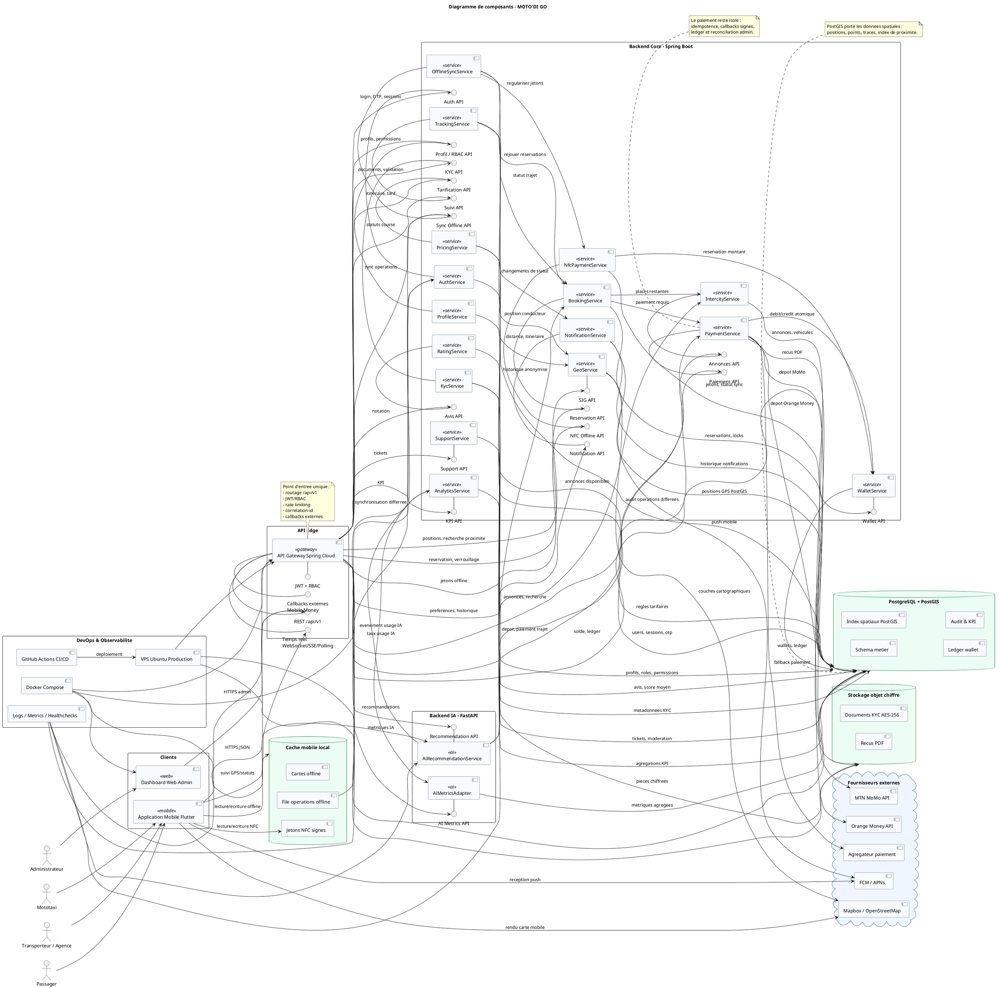

# Diagramme de composants - MOTO'DI GO

Ce diagramme presente la structure modulaire de MOTO'DI GO : chaque composant encapsule une responsabilite, expose ou consomme des interfaces, et communique avec les autres modules via des contrats explicites.

## Principes retenus

- Un composant UML represente une partie modulaire et substituable du systeme, decrite par ses interfaces fournies et requises.
- Les relations ci-dessous montrent des dependances de service, pas des appels de methode internes.
- La notation utilise PlantUML, qui supporte les composants, interfaces, packages, bases de donnees et clouds externes.
- Le backend-core est volontairement detaille en sous-composants fonctionnels, car le backlog le decompose en services metier coherents.

## Lecture rapide du diagramme

- **Clients** : l'application Flutter sert les passagers, mototaxis, transporteurs et agences ; le dashboard web sert l'administration.
- **API Gateway** : centralise les routes, la securite JWT/RBAC, le temps reel et les callbacks externes.
- **Backend Core** : contient les services metier principaux : identite, KYC, SIG, tarification, annonces, reservation, wallet, paiement, offline, support et analytics.
- **Backend IA** : isole l'assistant de recommandation de covoiturage et ses metriques.
- **Donnees** : PostgreSQL/PostGIS porte les donnees metier et geospatiales ; le stockage objet conserve les documents KYC et recus ; le cache mobile garde les cartes et operations offline.
- **Externes** : Mobile Money, push notifications et cartographie sont des dependances externes explicites.
- **DevOps** : Docker, CI/CD, VPS et observabilite sont modelises comme composants de support d'exploitation.

## Sources de notation

- [OMG UML 2.5.1](https://www.omg.org/spec/UML/2.5.1/) : specification formelle UML, langage de modelisation pour visualiser, specifier, construire et documenter des systemes distribues.
- [PlantUML - Component Diagram](https://plantuml.com/component-diagram) : syntaxe officielle des composants, interfaces, packages, bases de donnees, clouds, ports et relations.

