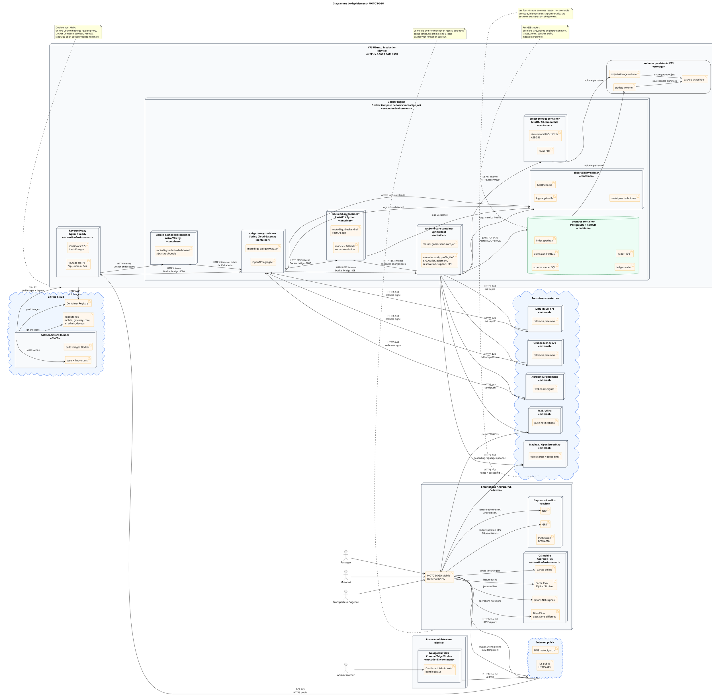

# Diagramme de deploiement - MOTO'DI GO

Ce diagramme montre la repartition physique et logique des artefacts logiciels MOTO'DI GO sur les noeuds d'execution : terminaux mobiles, navigateur web admin, Internet, VPS de production, conteneurs Docker, base PostgreSQL/PostGIS, stockage, services externes et pipeline CI/CD.

## Principes retenus

- Un **noeud de deploiement** represente une ressource d'execution : appareil mobile, navigateur, serveur Linux, moteur Docker, conteneur, base de donnees ou service cloud.
- Un **artefact** represente un livrable deploye : APK/IPA Flutter, bundle web, JAR Spring Boot, application FastAPI, image Docker, schema SQL, fichiers KYC.
- Un **chemin de communication** indique le protocole reseau utilise : HTTPS/TLS, WSS/SSE, TCP, JDBC, Docker bridge, SSH, webhooks, push.
- Le diagramme correspond a une cible MVP/V1 deployable sur un VPS Ubuntu, avec possibilite de separer plus tard la base de donnees, le stockage et les services metier sur des noeuds dedies.

## Connexions reseau principales

| Source | Destination | Protocole | Usage |
|---|---|---|---|
| Application mobile | Reverse proxy/API Gateway | HTTPS/TLS 1.3, TCP 443 | REST `/api/v1`, auth, reservation, paiement, support |
| Application mobile | API Gateway | WSS/SSE/long polling sur TLS | Suivi trajet, GPS, statuts temps reel |
| Navigateur admin | Reverse proxy/dashboard | HTTPS/TLS 1.3, TCP 443 | Back-office, moderation, KPI |
| Reverse proxy | Gateway/Admin container | HTTP Docker bridge | Routage interne `/api`, `/admin`, `/ws` |
| Gateway | Backend core | HTTP REST interne | Services metier |
| Gateway | Backend IA | HTTP REST interne | Recommandations IA |
| Backend core | PostgreSQL/PostGIS | JDBC/TCP 5432 | Donnees metier et geospatiales |
| Backend core | Stockage objet | S3 API interne | Documents KYC, recus |
| Backend core | MTN/Orange/agregateur | HTTPS/TLS 443 | Initiation paiement |
| Fournisseurs paiement | API Gateway | HTTPS/TLS 443 | Callbacks/webhooks signes |
| Backend core | FCM/APNs | HTTPS/TLS 443 | Push notifications |
| Mobile/backend | Mapbox/OpenStreetMap | HTTPS/TLS 443 | Cartes, geocoding, routage |
| GitHub Actions | VPS | SSH 22 | Deploiement production |
| VPS | Registry | HTTPS/TLS 443 | Pull images Docker |

## Sources de notation

- [OMG UML 2.5.1](https://www.omg.org/spec/UML/2.5.1/) : specification UML formelle.
- [PlantUML - Deployment Diagram](https://plantuml.com/deployment-diagram) : syntaxe officielle pour `node`, `artifact`, `database`, `cloud`, liens et imbrications.

