# Diagramme d'objets - MOTO'DI GO

Ce diagramme instancie le diagramme de classes `diagramme_classes_motodi_go.md` avec un scenario concret : une passagere recherche un trajet Douala -> Yaounde, consulte une recommandation IA, reserve une place, paie via wallet/Mobile Money, puis recoit les notifications et laisse une note apres trajet.

## Hypotheses de donnees

- Les coordonnees sont stockees en `latitude` / `longitude`, mais les geometries WKT/PostGIS utilisent l'ordre geospatial usuel `POINT(longitude latitude)` avec SRID 4326.
- Les numeros de telephone camerounais sont modelises en E.164 : `+237` suivi de 9 chiffres nationaux.
- Les plaques camerounaises sont illustrees avec un code regional, par exemple `LT` pour Littoral.
- Le champ `licenseNumber` du taximan est volontairement traite comme une reference administrative opaque. Je n'ai pas trouve de format public officiel stable pour un numero de licence de taximan au Cameroun ; l'exemple `PERMIS-CMR-LT-A-2026-004219` sert donc de nomenclature interne temporaire, pas de format legal.

```mermaid
classDiagram
direction LR

class userAline["userAline:User"] {
  id = "usr-001"
  phoneNumber = "+237699001122"
  fullName = "Aline Ngo Bayi"
  email = "aline.ngo@example.cm"
  locale = "fr-CM"
  cguAccepted = true
  status = ACTIVE
  phoneVerifiedAt = "2026-07-02T08:10:00+01:00"
}

class userBika["userBika:User"] {
  id = "usr-002"
  phoneNumber = "+237677223344"
  fullName = "Jean Bika"
  locale = "fr-CM"
  cguAccepted = true
  status = ACTIVE
}

class userAdmin["userAdmin:User"] {
  id = "usr-900"
  phoneNumber = "+237620000001"
  fullName = "Mireille Admin"
  status = ACTIVE
}

class sessionAline["sessionAline:Session"] {
  id = "ses-001"
  deviceId = "android-pixel-8"
  ipAddress = "102.244.12.40"
  issuedAt = "2026-07-02T08:12:00+01:00"
  expiresAt = "2026-07-02T10:12:00+01:00"
  status = ACTIVE
}

class otpAline["otpAline:OtpCode"] {
  id = "otp-001"
  destinationPhone = "+237699001122"
  purpose = REGISTRATION
  attempts = 1
  expiresAt = "2026-07-02T08:20:00+01:00"
  consumedAt = "2026-07-02T08:09:20+01:00"
}

class passagerAline["passagerAline:PassengerProfile"] {
  id = "prf-pass-001"
  type = PASSENGER
  validationStatus = VALIDATED
  displayName = "Aline"
  preferredLanguage = "fr"
  emergencyContact = "+237677000000"
  averageRating = 4.8
  active = true
}

class conducteurBika["conducteurBika:MotoTaxiProfile"] {
  id = "prf-moto-002"
  type = MOTOTAXI
  validationStatus = VALIDATED
  displayName = "Bika Moto"
  licenseNumber = "PERMIS-CMR-LT-A-2026-004219"
  operatingZone = "Douala - Bonamoussadi"
  availability = AVAILABLE
  gpsConsent = true
  averageRating = 4.6
}

class transporteurBika["transporteurBika:TransporterProfile"] {
  id = "prf-trans-002"
  type = TRANSPORTER
  validationStatus = VALIDATED
  displayName = "Bika Intercity"
  permitNumber = "TR-CMR-LT-2026-000781"
  companyName = "Bika Voyages"
  availability = AVAILABLE
}

class adminMireille["adminMireille:AdminProfile"] {
  id = "prf-admin-900"
  type = ADMIN
  validationStatus = VALIDATED
  adminRole = PLATFORM_ADMIN
  permissions = "KYC,PRICING,PAYMENT,MODERATION"
}

class motoBika["motoBika:Vehicle"] {
  id = "veh-101"
  type = MOTORCYCLE
  plateNumber = "LT4521AB"
  brand = "TVS"
  model = "Apache RTR"
  capacity = 1
  color = "jaune"
  validationStatus = VALIDATED
  active = true
}

class vanAgence["vanAgence:Vehicle"] {
  id = "veh-202"
  type = VAN
  plateNumber = "LT7832CD"
  brand = "Toyota"
  model = "Hiace"
  capacity = 14
  color = "blanc"
  validationStatus = VALIDATED
  active = true
}

class permisBika["permisBika:OfficialDocument"] {
  id = "doc-lic-002"
  type = DRIVER_LICENSE
  status = ACCEPTED
  encryptedStorageKey = "s3://kyc/enc/doc-lic-002"
  mimeType = "application/pdf"
  sizeBytes = 482144
  checksum = "sha256:6d7e...b91"
  uploadedAt = "2026-07-01T15:20:00+01:00"
}

class decisionKycBika["decisionKycBika:ValidationDecision"] {
  id = "dec-002"
  decision = VALIDATE
  reason = "Permis et assurance lisibles"
  decidedAt = "2026-07-01T17:45:00+01:00"
}

class auditPermis["auditPermis:DocumentAccessAudit"] {
  id = "aud-002"
  action = VIEW
  actorRole = "PLATFORM_ADMIN"
  accessedAt = "2026-07-01T17:30:00+01:00"
  correlationId = "corr-kyc-20260701-01"
}

class pointDouala["pointDouala:GeoPoint"] {
  latitude = 4.05105637
  longitude = 9.76786863
  postgisGeometry = "SRID=4326;POINT(9.76786863 4.05105637)"
}

class pointYaounde["pointYaounde:GeoPoint"] {
  latitude = 3.87
  longitude = 11.52
  postgisGeometry = "SRID=4326;POINT(11.52 3.87)"
}

class positionBika["positionBika:DriverPosition"] {
  id = "pos-002-001"
  point = "SRID=4326;POINT(9.751535 4.096381)"
  speedKmh = 28.4
  accuracyMeters = 8.0
  capturedAt = "2026-07-02T08:35:05+01:00"
  receivedAt = "2026-07-02T08:35:06+01:00"
  consentConfirmed = true
}

class routeDoualaYaounde["routeDoualaYaounde:Route"] {
  id = "rte-001"
  origin = "Douala"
  destination = "Yaounde"
  polyline = "LINESTRING(9.76786863 4.05105637,10.45 3.95,11.52 3.87)"
  distanceKm = 242.6
  durationMinutes = 210
  status = ACTIVE
}

class coucheTravauxEdea["coucheTravauxEdea:TrafficLayer"] {
  id = "trf-003"
  type = ROADWORK
  label = "Travaux axe Douala-Yaounde vers Edea"
  geometry = "SRID=4326;LINESTRING(10.12 3.80,10.18 3.82)"
  severity = MEDIUM
  active = true
}

class regleJourInterurbain["regleJourInterurbain:PricingRule"] {
  id = "prc-001"
  zoneCode = "CM-LT-CE"
  timeWindow = "05:00-21:59"
  baseFare = 500
  pricePerKm = 35
  nightCoefficient = 1.25
  weatherCoefficient = 1.00
  active = true
}

class estimationDoualaYaounde["estimationDoualaYaounde:FareEstimate"] {
  id = "fare-001"
  amountFcfa = 9000
  distanceKm = 242.6
  durationMinutes = 210
  appliedRulesTrace = "base 500 + 242.6km*35, arrondi"
  calculatedAt = "2026-07-02T08:36:00+01:00"
}

class trajetIntercity["trajetIntercity:IntercityTrip"] {
  id = "trip-ic-001"
  type = INTERCITY
  status = CONFIRMED
  origin = "Douala"
  destination = "Yaounde"
  plannedDepartureAt = "2026-07-03T07:30:00+01:00"
  departureCity = "Douala"
  destinationCity = "Yaounde"
  departureQuarter = "Bonamoussadi"
  availableSeats = 3
  finalPriceFcfa = 9000
}

class annonceBika["annonceBika:IntercityAnnouncement"] {
  id = "ann-001"
  departureCity = "Douala"
  destinationCity = "Yaounde"
  departureQuarter = "Bonamoussadi"
  departureDate = "2026-07-03"
  departureTime = "07:30"
  priceFcfa = 9000
  totalSeats = 14
  remainingSeats = 3
  instructions = "Depart station Bonamoussadi, arrivee Mvan"
  status = PUBLISHED
}

class rechercheAline["rechercheAline:AnnouncementSearchCriteria"] {
  departureCity = "Douala"
  destinationCity = "Yaounde"
  date = "2026-07-03"
  maxPrice = 10000
  quarter = "Bonamoussadi"
  timeRange = "06:00-09:00"
  onlyAvailable = true
}

class reservationAline["reservationAline:Booking"] {
  id = "book-001"
  status = PAID
  seatsRequested = 1
  requestedAt = "2026-07-02T08:39:00+01:00"
  confirmedAt = "2026-07-02T08:41:10+01:00"
  expiresAt = "2026-07-02T08:49:00+01:00"
}

class verrouPlaceAline["verrouPlaceAline:SeatLock"] {
  id = "lock-001"
  seatsLocked = 1
  lockedAt = "2026-07-02T08:39:02+01:00"
  expiresAt = "2026-07-02T08:49:02+01:00"
  consumed = true
}

class eventConfirmed["eventConfirmed:TripEvent"] {
  id = "evt-001"
  status = CONFIRMED
  label = "Reservation payee et confirmee"
  occurredAt = "2026-07-02T08:41:12+01:00"
  source = "PaymentService"
}

class walletAline["walletAline:Wallet"] {
  id = "wal-001"
  currency = "XAF"
  currentBalance = 15000
  status = ACTIVE
  createdAt = "2026-07-02T08:10:30+01:00"
}

class walletBika["walletBika:Wallet"] {
  id = "wal-002"
  currency = "XAF"
  currentBalance = 45000
  status = ACTIVE
}

class depotMomoAline["depotMomoAline:MobileMoneyDeposit"] {
  id = "pay-dep-001"
  type = MOBILE_MONEY_DEPOSIT
  provider = MTN_MOMO
  status = CONFIRMED
  amount = 25000
  currency = "XAF"
  externalReference = "MTN-20260702-8A91"
  payerPhone = "+237699001122"
  confirmedAt = "2026-07-02T08:25:30+01:00"
}

class paiementTrajetAline["paiementTrajetAline:RidePayment"] {
  id = "pay-ride-001"
  type = RIDE_PAYMENT
  status = CONFIRMED
  amount = 9000
  currency = "XAF"
  platformFee = 900
  transporterAmount = 8100
  idempotencyKey = "book-001-pay-001"
  confirmedAt = "2026-07-02T08:41:10+01:00"
}

class debitAline["debitAline:LedgerEntry"] {
  id = "led-001"
  type = DEBIT
  amount = 9000
  currency = "XAF"
  reference = "pay-ride-001"
  bookedAt = "2026-07-02T08:41:10+01:00"
}

class creditBika["creditBika:LedgerEntry"] {
  id = "led-002"
  type = CREDIT
  amount = 8100
  currency = "XAF"
  reference = "pay-ride-001"
  bookedAt = "2026-07-02T08:41:10+01:00"
}

class recuAline["recuAline:Receipt"] {
  id = "rcp-001"
  receiptNumber = "MDG-20260702-0001"
  amount = 9000
  currency = "XAF"
  issuedAt = "2026-07-02T08:41:12+01:00"
  pdfUrl = "s3://receipts/MDG-20260702-0001.pdf"
}

class notifConfirmation["notifConfirmation:Notification"] {
  id = "not-001"
  type = CONFIRMATION
  title = "Place confirmee"
  body = "Votre trajet Douala -> Yaounde est confirme."
  status = SENT
  sentAt = "2026-07-02T08:41:14+01:00"
}

class prefAline["prefAline:NotificationPreference"] {
  id = "npf-001"
  pushEnabled = true
  bookingUpdates = true
  paymentAlerts = true
  marketingEnabled = false
}

class carteOfflineAline["carteOfflineAline:OfflineMapArea"] {
  id = "map-001"
  areaName = "Axe Douala-Yaounde"
  boundingBox = "9.70,3.80,11.60,4.10"
  sizeBytes = 84200000
  downloadedAt = "2026-07-02T09:00:00+01:00"
  expiresAt = "2026-08-02T09:00:00+01:00"
}

class jetonNfcAline["jetonNfcAline:NfcPaymentToken"] {
  id = "nfc-001"
  signedToken = "nfc.v1.book-001.sig"
  amount = 9000
  issuedAt = "2026-07-02T09:05:00+01:00"
  expiresAt = "2026-07-03T12:00:00+01:00"
  status = ISSUED
}

class opOfflineNfc["opOfflineNfc:OfflineOperation"] {
  id = "off-001"
  type = NFC_PAYMENT
  idempotencyKey = "nfc-001-sync"
  status = QUEUED
  retryCount = 0
  queuedAt = "2026-07-03T07:20:00+01:00"
}

class batchSync["batchSync:SyncBatch"] {
  id = "sync-001"
  startedAt = "2026-07-03T10:45:00+01:00"
  completedAt = "2026-07-03T10:45:08+01:00"
  status = COMPLETED
}

class avisAline["avisAline:Rating"] {
  id = "rat-001"
  stars = 5
  comment = "Depart ponctuel, trajet propre."
  status = PUBLISHED
  createdAt = "2026-07-03T12:30:00+01:00"
}

class ticketAline["ticketAline:SupportTicket"] {
  id = "sup-001"
  category = TRANSPORT
  priority = MEDIUM
  status = RESOLVED
  subject = "Question sur point d'embarquement"
  createdAt = "2026-07-02T08:50:00+01:00"
  closedAt = "2026-07-02T09:10:00+01:00"
}

class reqIaAline["reqIaAline:AiRecommendationRequest"] {
  id = "ai-req-001"
  departureCity = "Douala"
  destinationCity = "Yaounde"
  quarter = "Bonamoussadi"
  preferredTime = "06:00-09:00"
  requestedSeats = 1
  anonymizedUserContext = "hash:user-segment-regular"
}

class recoIaBika["recoIaBika:AiRecommendation"] {
  id = "ai-rec-001"
  score = 0.92
  reason = "Prix dans budget, depart proche, 3 places restantes"
  generatedAt = "2026-07-02T08:38:00+01:00"
  clicked = true
}

class kpiJour["kpiJour:KpiSnapshot"] {
  id = "kpi-20260702"
  periodStart = "2026-07-02"
  periodEnd = "2026-07-02"
  monthlyActiveUsers = 2
  activeVerifiedDrivers = 1
  reservationCount = 1
  walletVolumeFcfa = 34000
  slaAvailability = 99.9
  aiUsageRate = 1.0
}

class authSvc["authSvc:AuthService"] {
  runtime = "backend-core singleton"
}

class bookingSvc["bookingSvc:BookingService"] {
  runtime = "backend-core singleton"
}

class paymentSvc["paymentSvc:PaymentService"] {
  runtime = "backend-core singleton"
}

class geoSvc["geoSvc:GeoService"] {
  runtime = "backend-core singleton"
}

class aiSvc["aiSvc:AiRecommendationService"] {
  runtime = "backend-ai singleton"
}

userAline "1" *-- "1" passagerAline : possede
userAline "1" *-- "1" sessionAline : ouvre
userAline "1" *-- "1" otpAline : verifie
userAline "1" *-- "1" walletAline : detient
userAline "1" *-- "1" prefAline : configure
userAline "1" *-- "1" notifConfirmation : recoit
userAline "1" *-- "1" carteOfflineAline : telecharge
userAline "1" *-- "1" opOfflineNfc : empile
userAline "1" *-- "1" ticketAline : cree
userAline "1" --> "1" avisAline : evalue

userBika "1" *-- "1" conducteurBika : possede
userBika "1" *-- "1" transporteurBika : possede
userBika "1" *-- "1" walletBika : detient
conducteurBika "1" o-- "1" motoBika : utilise
transporteurBika "1" o-- "1" vanAgence : exploite
conducteurBika "1" *-- "1" positionBika : publie
conducteurBika "1" *-- "1" permisBika : fournit
conducteurBika "1" *-- "1" decisionKycBika : historique
permisBika "1" *-- "1" auditPermis : audit
adminMireille "1" --> "1" decisionKycBika : statue

routeDoualaYaounde "1" --> "1" pointDouala : origine
routeDoualaYaounde "1" --> "1" pointYaounde : destination
routeDoualaYaounde "1" --> "1" coucheTravauxEdea : evite
regleJourInterurbain "1" --> "1" estimationDoualaYaounde : produit
estimationDoualaYaounde "1" --> "1" routeDoualaYaounde : pour

transporteurBika "1" --> "1" annonceBika : publie
vanAgence "1" --> "1" annonceBika : affecte
annonceBika "1" --> "1" trajetIntercity : prepare
rechercheAline ..> annonceBika : filtre
passagerAline "1" --> "1" reservationAline : effectue
annonceBika "1" *-- "1" reservationAline : recoit
reservationAline "1" *-- "1" verrouPlaceAline : verrouille
reservationAline "1" --> "1" trajetIntercity : concerne
trajetIntercity "1" *-- "1" eventConfirmed : journalise
trajetIntercity "1" --> "1" estimationDoualaYaounde : tarif
trajetIntercity "1" --> "1" avisAline : autoriseApresFin

walletAline "1" *-- "1" debitAline : ledger
walletBika "1" *-- "1" creditBika : ledger
depotMomoAline "1" --> "1" walletAline : credite
paiementTrajetAline "1" --> "1" debitAline : comptabilise
paiementTrajetAline "1" --> "1" creditBika : comptabilise
reservationAline "1" --> "1" paiementTrajetAline : regleePar
paiementTrajetAline "1" *-- "1" recuAline : genere
jetonNfcAline "1" --> "1" walletAline : reserveMontant
opOfflineNfc "1" --> "1" jetonNfcAline : actionNfc
batchSync "1" *-- "1" opOfflineNfc : synchronise

notifConfirmation "1" --> "1" reservationAline : reference
notifConfirmation "1" --> "1" paiementTrajetAline : reference

reqIaAline "1" --> "1" annonceBika : analyse
reqIaAline "1" *-- "1" recoIaBika : retourne
recoIaBika "1" --> "1" annonceBika : suggere
kpiJour ..> userAline : compteMAU
kpiJour ..> conducteurBika : compteConducteurs
kpiJour ..> reservationAline : compteReservations
kpiJour ..> paiementTrajetAline : volumeWallet

authSvc ..> userAline : creeCompte
bookingSvc ..> reservationAline : souscrit
bookingSvc ..> verrouPlaceAline : verrouillePlace
paymentSvc ..> paiementTrajetAline : paieTrajet
paymentSvc ..> recuAline : genereRecu
geoSvc ..> positionBika : ingereGPS
aiSvc ..> recoIaBika : recommande
```

## References utilisees pour les valeurs d'exemple

- [PostGIS ST_GeomFromText](https://postgis.net/docs/ST_GeomFromText.html) : construit une geometrie depuis WKT et peut recevoir un SRID ; les exemples officiels montrent `POINT`, `LINESTRING` et SRID 4326.
- [PostGIS Data Management](https://postgis.net/docs/using_postgis_dbmanagement.html) : le modele geospatial indique qu'en systeme geodetique les coordonnees X/Y correspondent typiquement a longitude/latitude.
- [Douala](https://fr.wikipedia.org/wiki/Douala) : latitude 4.05105637 et longitude 9.76786863, EPSG:4326.
- [Yaounde](https://fr.wikipedia.org/wiki/Yaound%C3%A9) : latitude 3.87 et longitude 11.52.
- [Telephone numbers in Cameroon](https://en.wikipedia.org/wiki/Telephone_numbers_in_Cameroon) : indicatif `+237`, mobile national sur 9 chiffres commencant par `6`.
- [Vehicle registration plates of Cameroon](https://en.wikipedia.org/wiki/Vehicle_registration_plates_of_Cameroon) : schema avec code regional, dont `LT` pour Littoral.
- [Taxi au Cameroun](https://fr.wikipedia.org/wiki/Taxi_au_Cameroun) : les taximens et motos-taxis sont des modes de transport identifies dans l'usage local.
