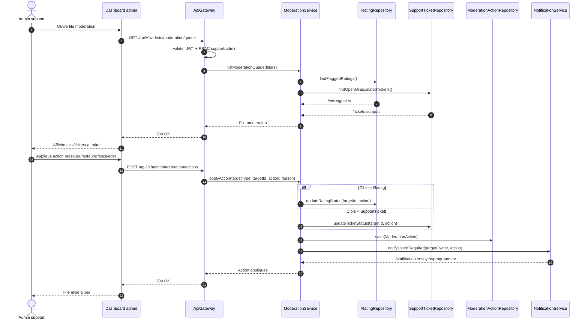
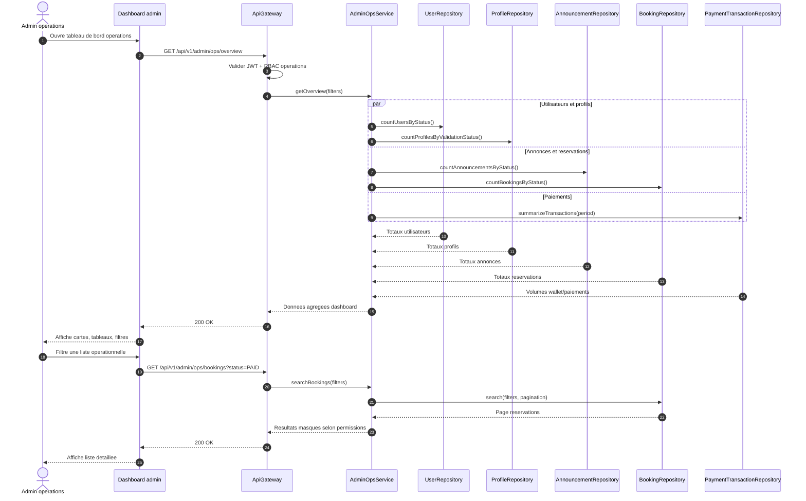
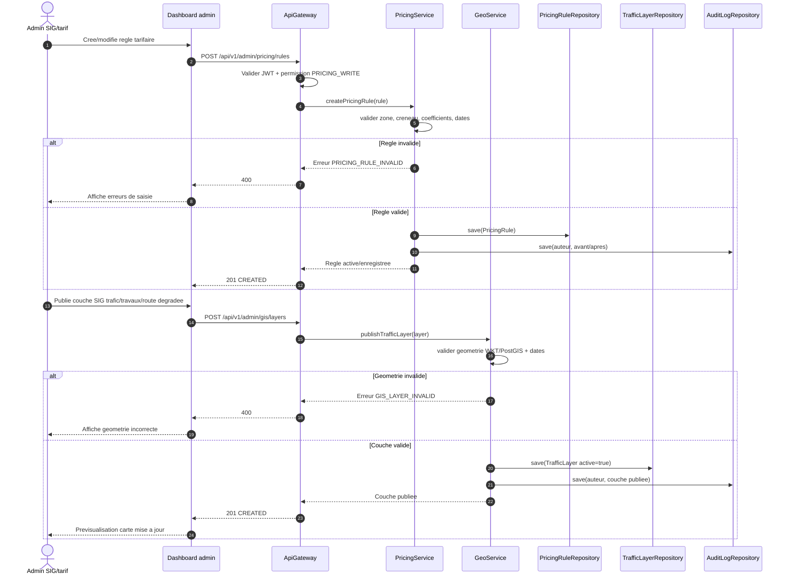
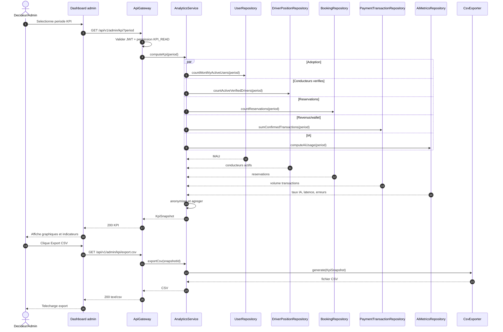
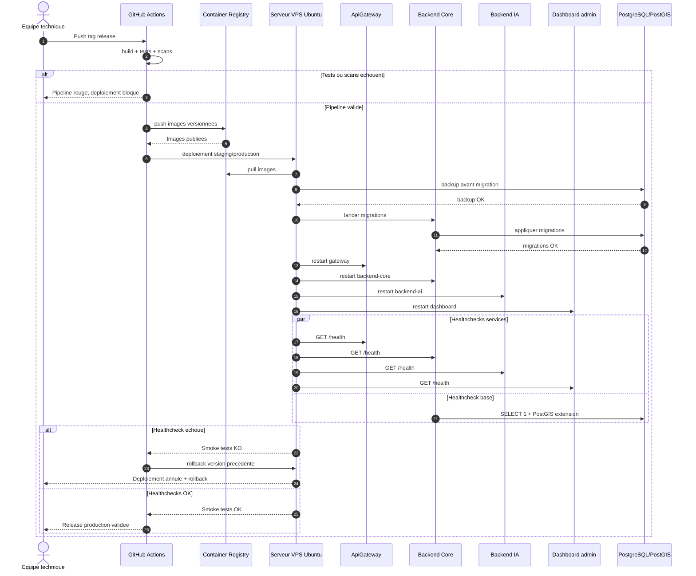

# Diagrammes de sequence - Admin, analytics et production MOTO'DI GO

Ces diagrammes couvrent les workflows demandes : moderation avis/support, dashboard admin operations, parametrage des regles tarifaires/SIG, calcul et export KPI, deploiement/healthcheck production.

## 26. Moderation avis/support

## 27. Dashboard admin operations

## 28. Parametrage regles tarifaires/SIG

## 29. Calcul et export KPI

## 30. Deploiement et healthcheck production

