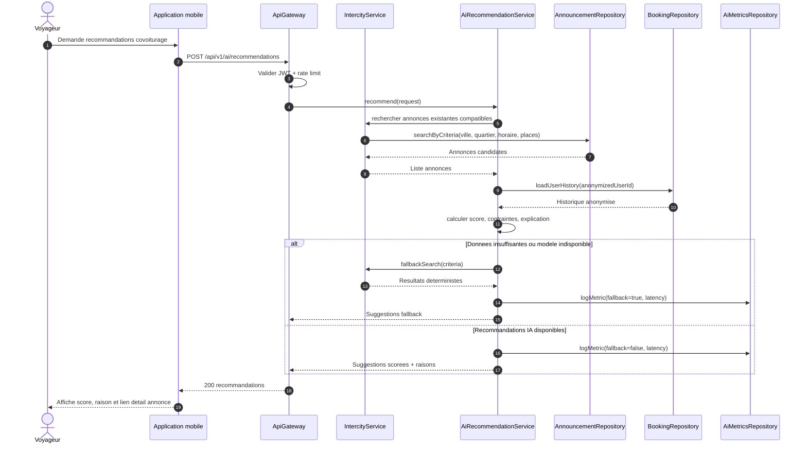
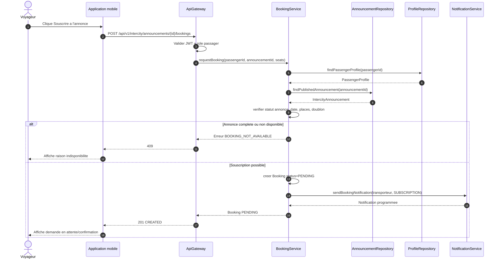
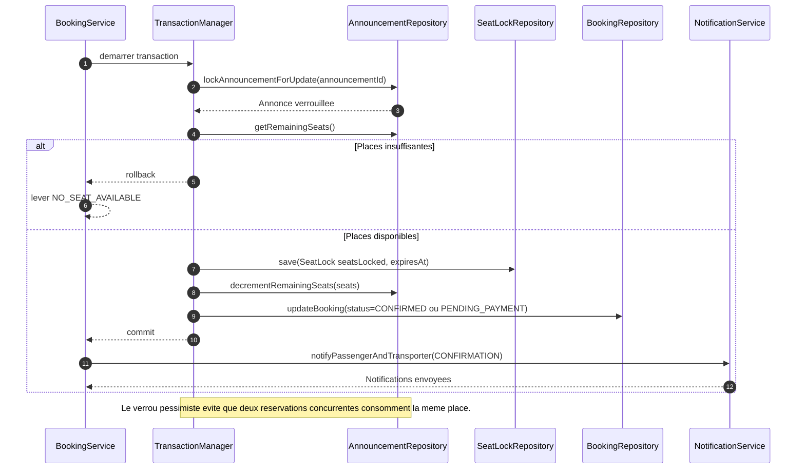
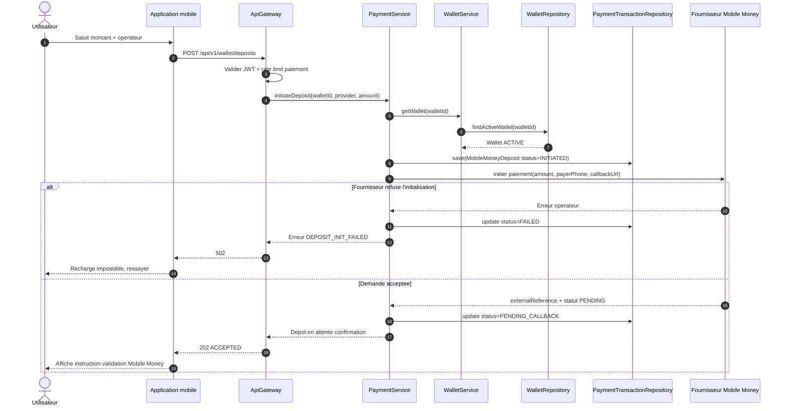
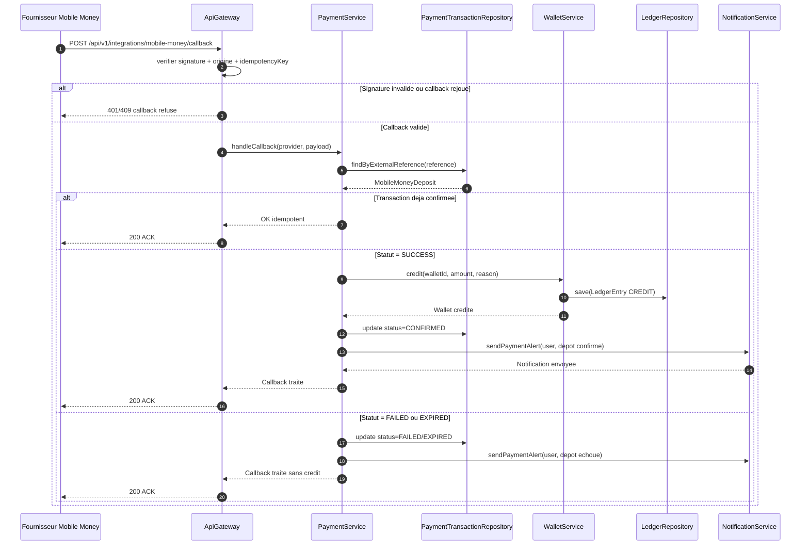

# Diagrammes de sequence - IA, reservation et wallet MOTO'DI GO

Ces diagrammes couvrent les workflows demandes : recommandation IA de covoiturage, souscription a une annonce, verrouillage de place, recharge wallet Mobile Money et callback Mobile Money.

## 11. Recommandation IA de covoiturage

## 12. Souscription a une annonce

## 13. Verrouillage de place

## 14. Recharge wallet Mobile Money

## 15. Callback Mobile Money

