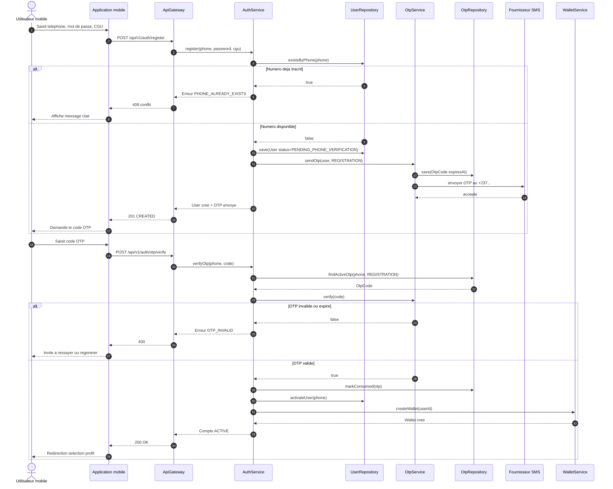
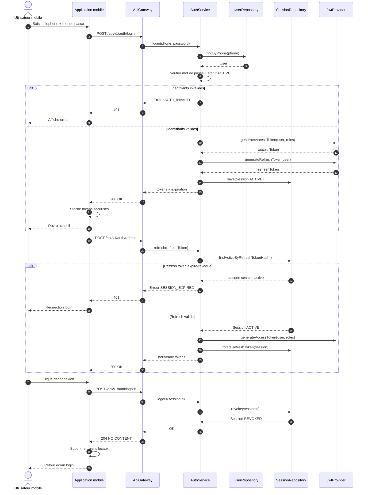
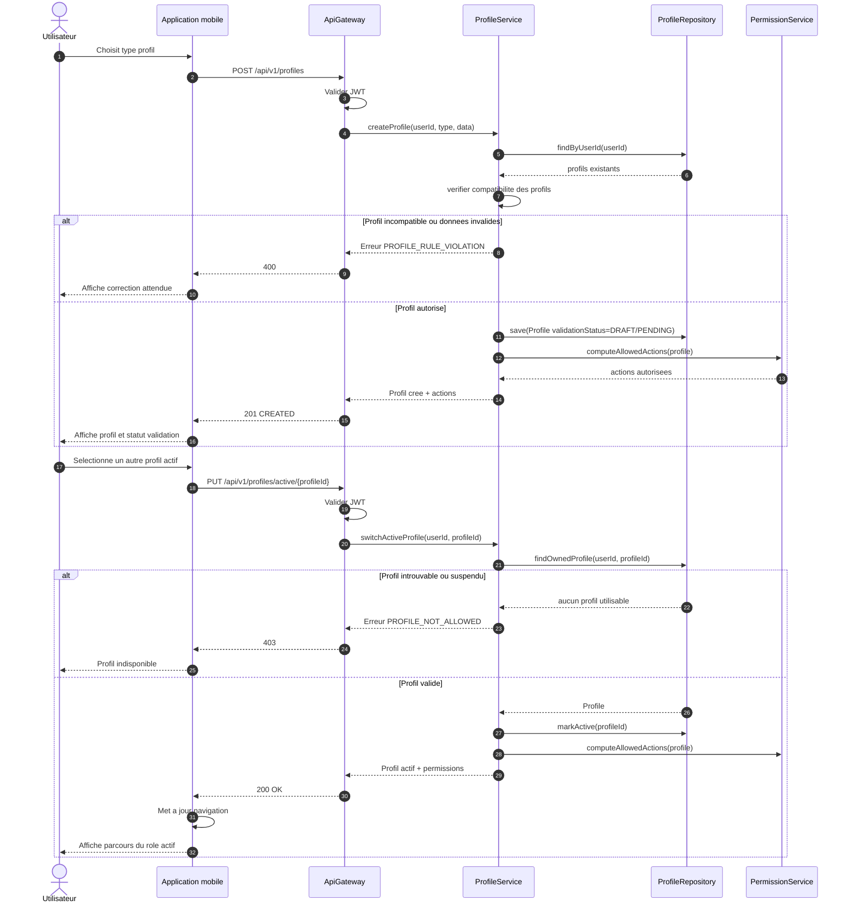
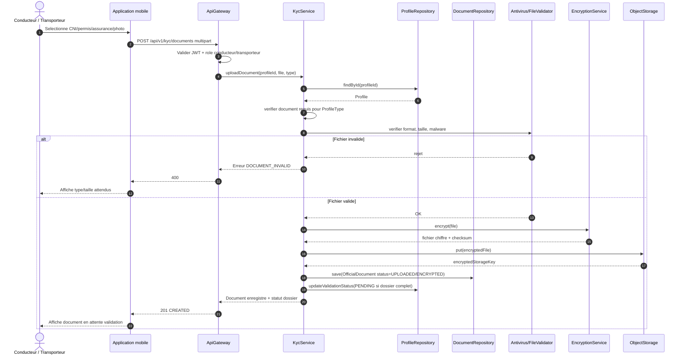
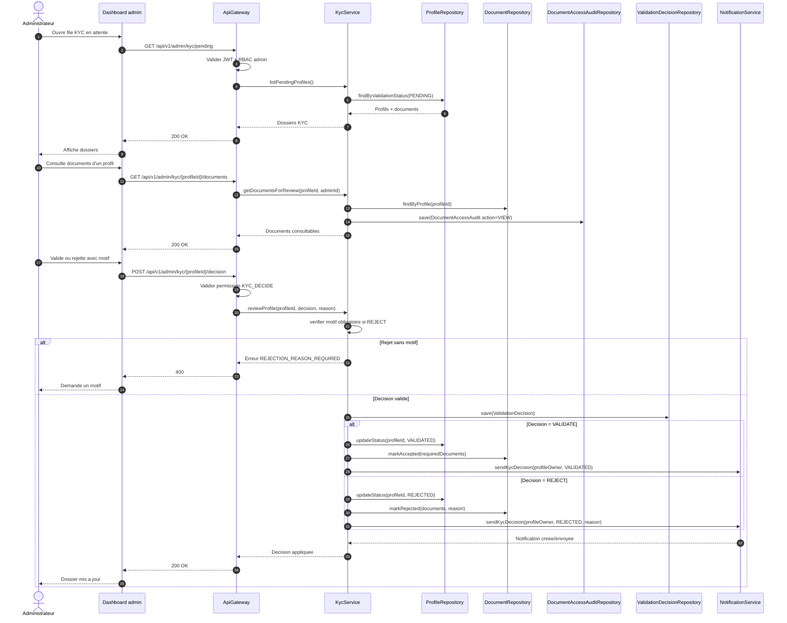

# Diagrammes de sequence - Identite et KYC MOTO'DI GO

Ces diagrammes couvrent les workflows demandes : inscription + OTP, connexion/session, profils, upload KYC et validation/rejet administratif.

## 1. Inscription utilisateur + verification OTP

## 2. Connexion, refresh token et deconnexion

## 3. Creation et changement de profil actif

## 4. Upload documents KYC

## 5. Validation ou rejet KYC par admin

