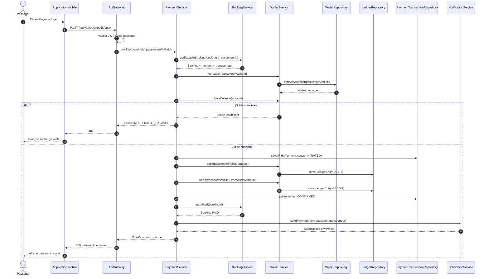
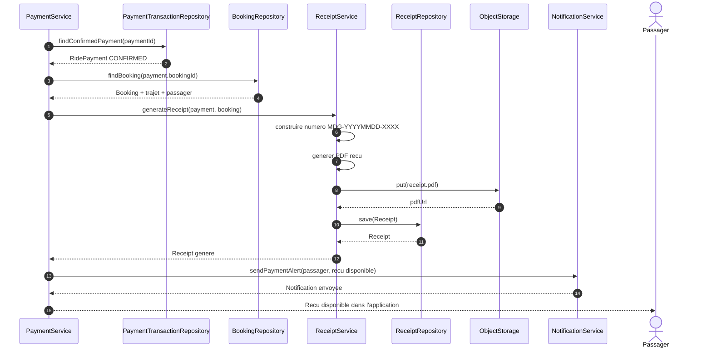
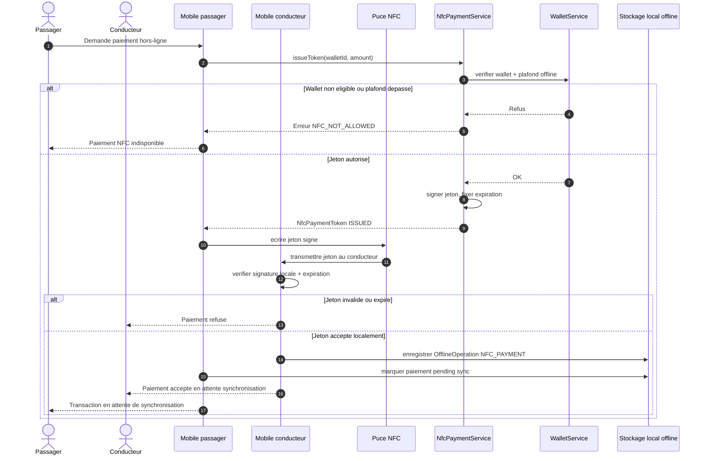
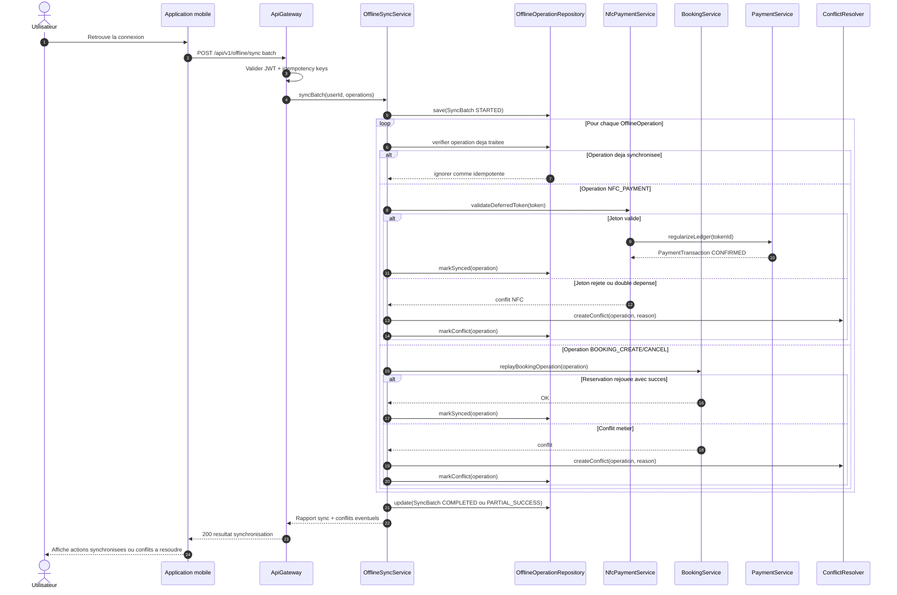
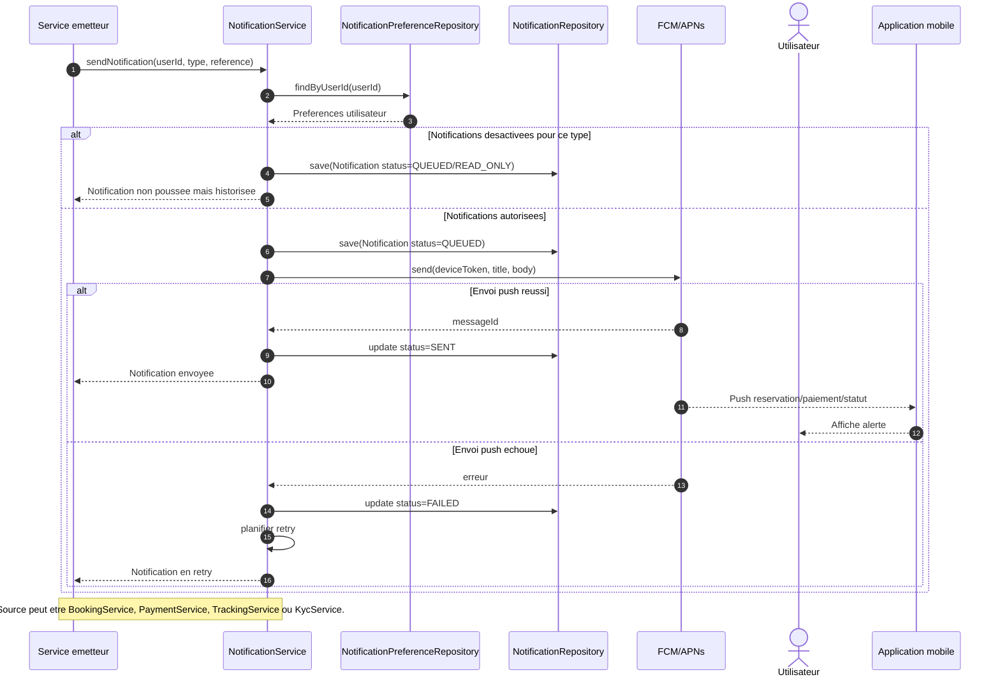

# Diagrammes de sequence - Paiement, offline et notifications MOTO'DI GO

Ces diagrammes couvrent les workflows demandes : paiement d'un trajet via wallet, generation du recu, paiement NFC hors-ligne, synchronisation des actions offline et notifications reservation/paiement/statut.

## 16. Paiement d'un trajet via wallet

## 17. Generation du recu

## 18. Paiement NFC hors-ligne

## 19. Synchronisation des actions offline

## 20. Notifications reservation, paiement et statut

