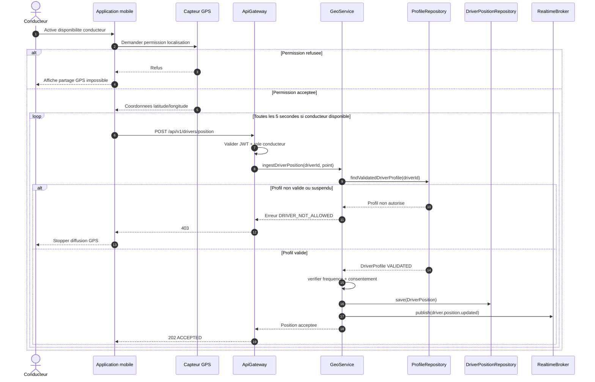
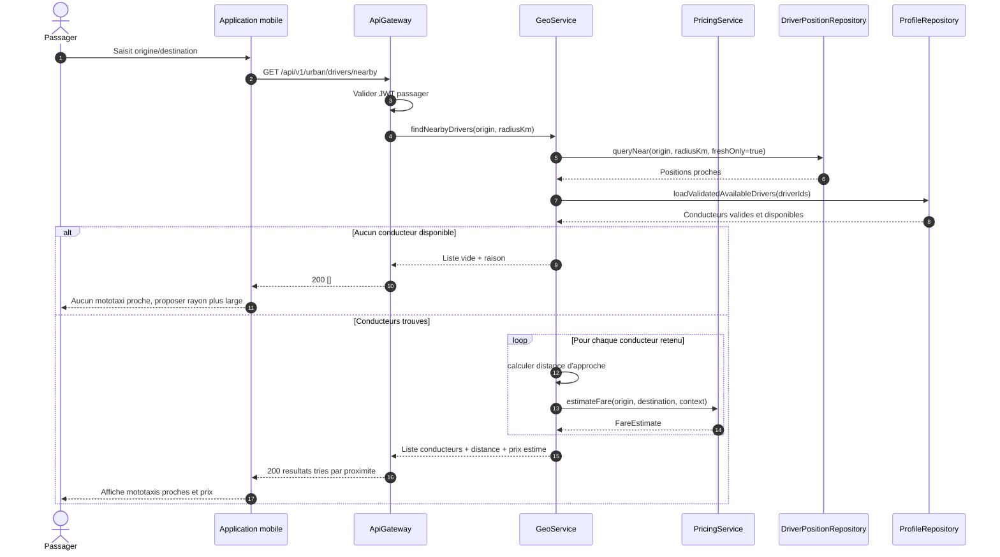
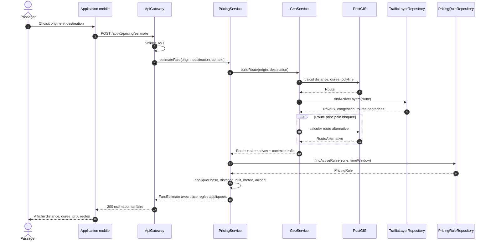
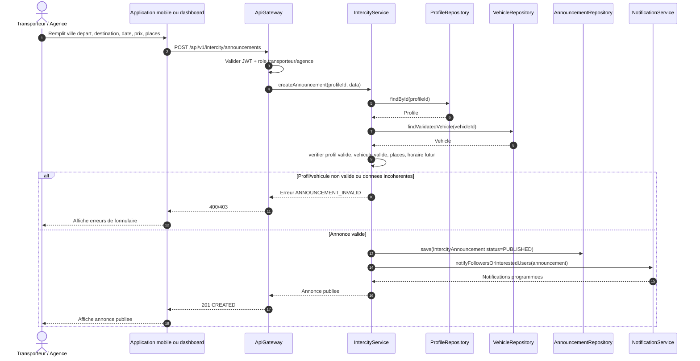
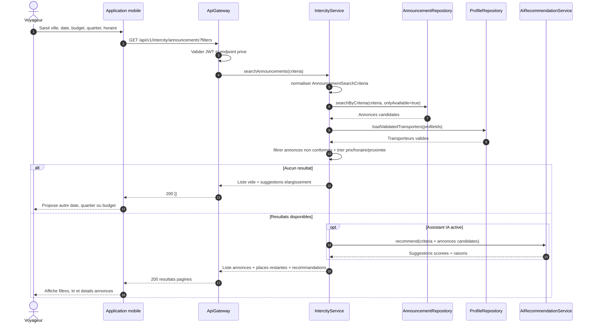

# Diagrammes de sequence - SIG, tarification et annonces MOTO'DI GO

Ces diagrammes couvrent les workflows demandes : partage GPS conducteur, recherche mototaxi proche, calcul itineraire + tarif standardise, publication d'annonce interurbaine et recherche/filtrage d'annonces.

## 6. Partage GPS conducteur

## 7. Recherche mototaxi proche

## 8. Calcul itineraire + tarif standardise

## 9. Publication d'annonce interurbaine

## 10. Recherche et filtrage d'annonces

