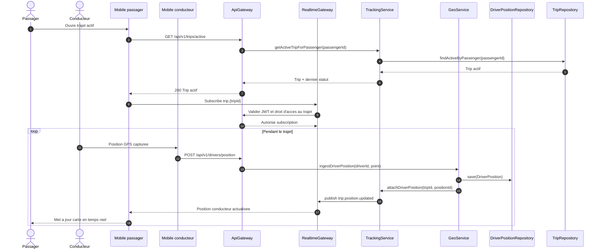
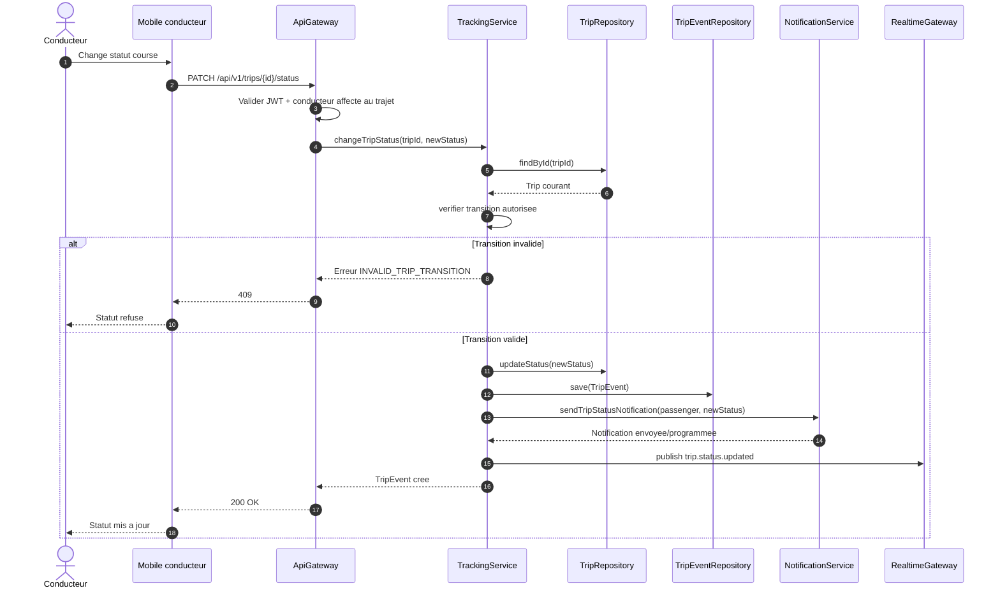
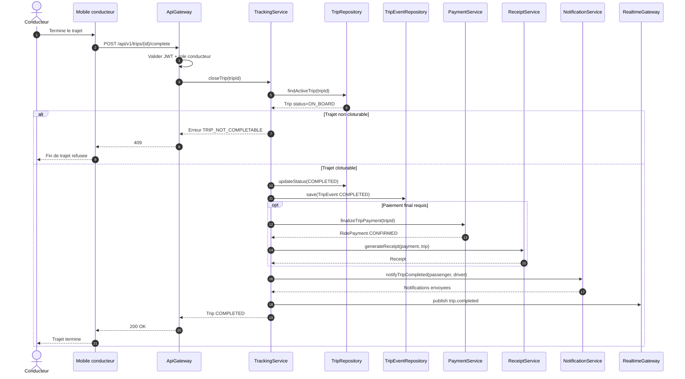
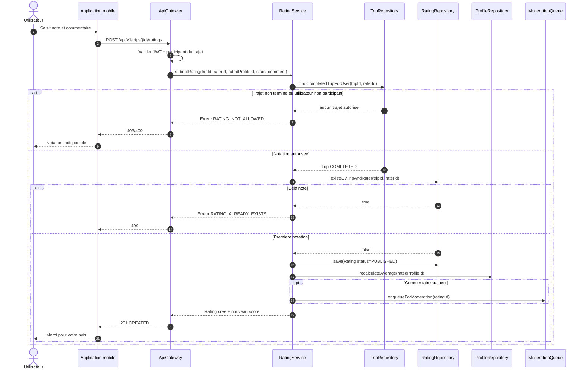
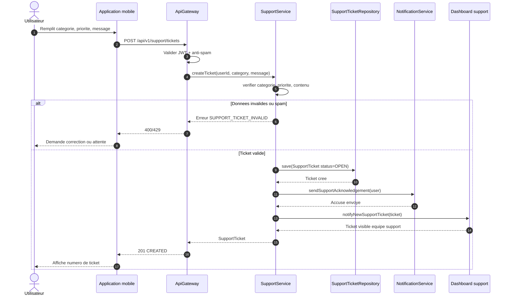

# Diagrammes de sequence - Suivi, post-trajet et support MOTO'DI GO

Ces diagrammes couvrent les workflows demandes : suivi de trajet en temps reel, changement de statut de course, fin de trajet, notation post-trajet et creation de ticket support.

## 21. Suivi de trajet en temps reel

## 22. Changement de statut de course

## 23. Fin de trajet

## 24. Notation post-trajet

## 25. Creation ticket support

